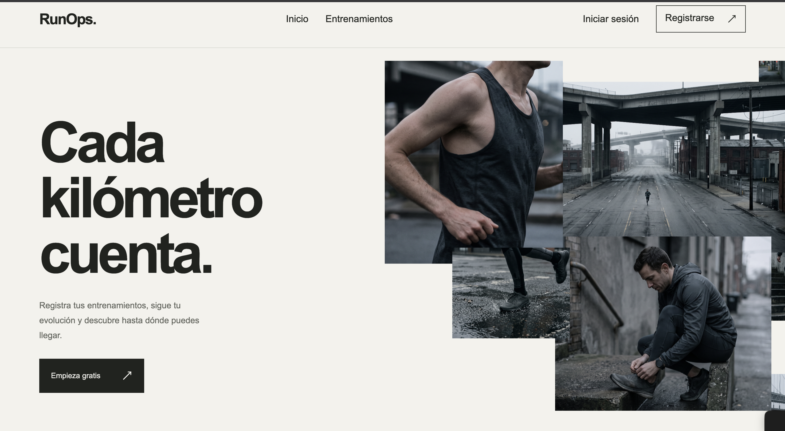
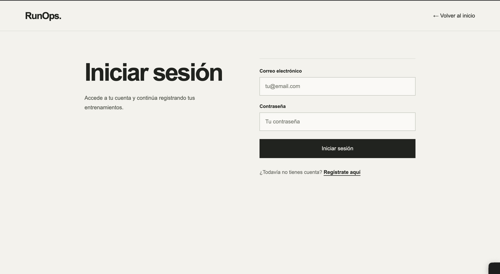
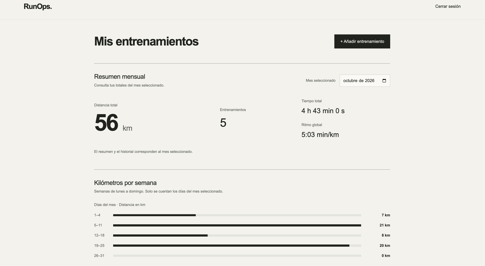
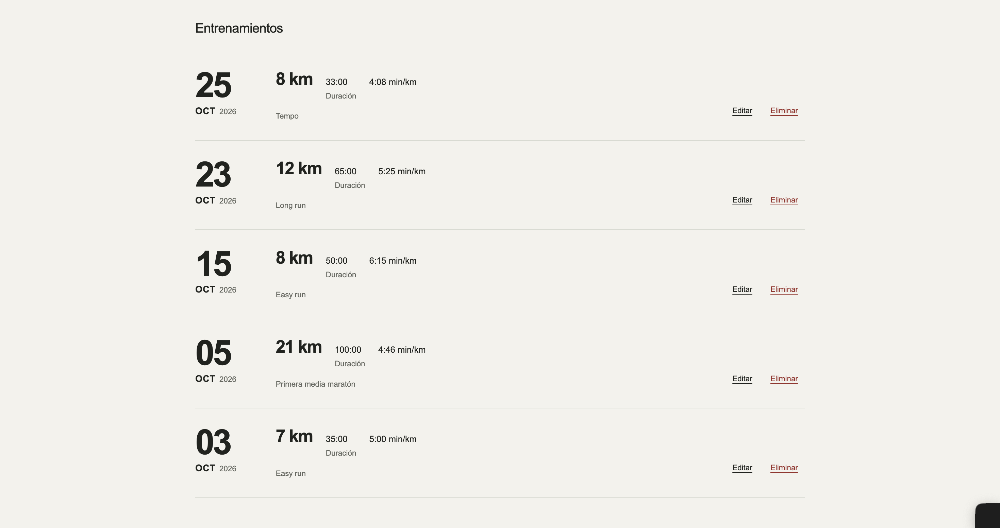

# RunOps

RunOps es una aplicación web full-stack para corredores amateurs que permite registrar entrenamientos y seguir su evolución con el tiempo.

El proyecto está desarrollado como portfolio personal, con especial foco en backend, autenticación, testing, CI/CD y despliegue.

**Demo:** [https://runops.onrender.com](https://runops.onrender.com)

> La aplicación está desplegada en el plan gratuito de Render, por lo que la primera carga puede tardar unos segundos si el servicio estaba en reposo.

## Capturas

### Landing



### Inicio de sesión



### Dashboard



### Historial de entrenamientos



## Funcionalidades

- Registro, inicio y cierre de sesión
- Autenticación basada en sesión con protección CSRF
- Crear, editar y eliminar entrenamientos
- Cada usuario solo puede acceder a sus propios entrenamientos
- Cálculo automático del ritmo medio
- Resumen mensual
- Historial filtrado por mes
- Gráfico de distancia semanal
- Interfaz responsive
- Tests automatizados de backend y frontend
- Integración continua con GitHub Actions
- Despliegue automático tras pasar los checks de CI

## Tecnologías

### Backend

- Java 21
- Spring Boot
- Spring Security
- Spring Data JPA
- PostgreSQL

### Frontend

- Angular
- TypeScript
- Reactive Forms
- Signals
- RxJS

### Infraestructura

- Docker
- GitHub Actions
- Render
- Neon PostgreSQL

## Arquitectura

```text
Angular
   ↓
Spring Boot REST API
   ↓
PostgreSQL
```

En producción, Angular se compila y se sirve desde la propia aplicación Spring Boot dentro del mismo contenedor Docker.

La autenticación utiliza sesiones HTTP. El backend obtiene siempre el usuario autenticado desde la sesión, por lo que el frontend no necesita enviar un `userId` al gestionar entrenamientos.

## Ejecución local

Levantar PostgreSQL:

```bash
docker compose up -d
```

Backend:

```bash
cd backend
./mvnw spring-boot:run
```

Frontend:

```bash
cd frontend
npm start
```

El servidor de desarrollo de Angular utiliza un proxy para enviar las peticiones `/api` al backend de Spring Boot.

## Tests

Backend:

```bash
cd backend
./mvnw verify
```

Frontend:

```bash
cd frontend
npm test -- --watch=false
```

GitHub Actions ejecuta los tests del backend, los tests del frontend y el build de producción en los pull requests y cambios sobre `main`.

## Despliegue

La aplicación se empaqueta en una imagen Docker multi-stage.

- **Aplicación:** Render
- **Base de datos:** Neon PostgreSQL
- **CI/CD:** GitHub Actions + Render Auto-Deploy

Los cambios en `main` se despliegan automáticamente cuando los checks de CI terminan correctamente.

## Estado
RunOps está en desarrollo activo como proyecto de portfolio. La versión actual es funcional y está desplegada públicamente, y se seguirán añadiendo mejoras y nuevas funcionalidades.